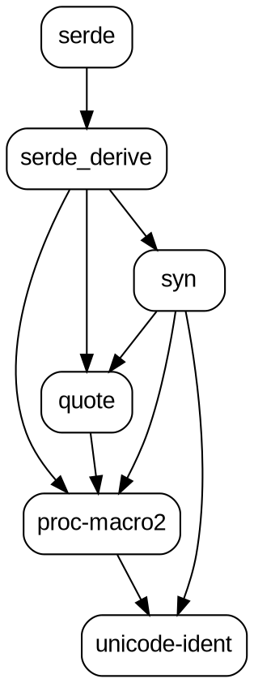
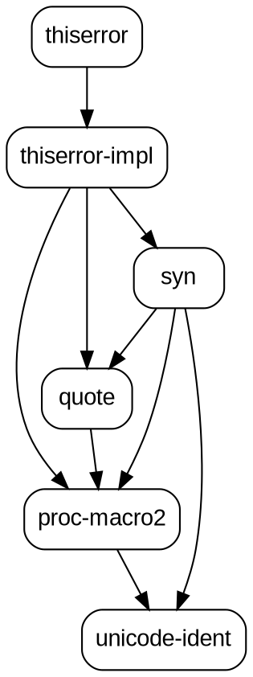

# Визуализатор графа зависимостей пакетов (Cargo)

## 1. Общее описание
CLI-инструмент для анализа и визуализации графа зависимостей пакетов формата Rust (Cargo) без использования сторонних менеджеров пакетов и библиотек получения зависимостей.

## 2. Описание всех функций и настроек
Приложение считывает параметры из конфигурационного файла формата CSV (`key,value`):
- `package_name` — имя анализируемого пакета (строка без пробелов).
- `repo_url` — URL-адрес индекса репозитория Cargo (например, `https://index.crates.io`) или путь к файлу тестового репозитория (например, `test_repo.txt`).
- `test_mode` — режим работы с тестовым репозиторием (`true` / `false`).
- `output_file` — имя выходного файла с изображением графа (`.png`).

Дополнительные опции CLI:
- `--load-order` — режим вывода порядка загрузки зависимостей (post-order DFS).

Модули проекта:
- `config_parser.py` — загрузка и валидация CSV-конфигурации.
- `cargo_fetcher.py` — получение прямых зависимостей пакетов Cargo по HTTP из индекса crates.io.
- `graph_builder.py` — построение транзитивного графа алгоритмом DFS с рекурсией, выявление циклов и расчет порядка загрузки.
- `visualizer.py` — генерация описания графа на языке диаграмм Graphviz (DOT) и рендеринг изображения в формате PNG через утилиту `dot` (с резервным рендерингом через Kroki API, если Graphviz не установлен локально).

## 3. Описание команд для сборки проекта и запуска тестов
Установка Graphviz (для локального рендеринга PNG):
- Windows: `winget install Graphviz.Graphviz`
- Ubuntu/Debian: `sudo apt install graphviz`
- macOS: `brew install graphviz`

Запуск модульных тестов:
```bash
python -m unittest discover -s tests
```

Запуск визуализации графа (сохранение в PNG):
```bash
python -m src.main --config config.csv
```

## 4. Примеры использования и сравнение с Cargo

### Примеры визуализации для трех различных пакетов

**Пример 1: пакет `serde`** (`output_file: serde.png`)


**Пример 2: пакет `anyhow`** (`output_file: anyhow.png`)


**Пример 3: пакет `thiserror`** (`output_file: thiserror.png`)


### Сравнение со штатными инструментами (`cargo tree` / `cargo-depgraph`)
При сравнении построенного графа с выводом `cargo tree -e normal` или графами `cargo-depgraph` наблюдаются следующие различия:
1. **Выбор версий (Latest vs SemVer-резолвер)**: инструмент анализирует последнюю не отозванную версию каждого пакета из индекса, в то время как `cargo tree` строит граф для конкретных версий, зафиксированных в `Cargo.lock` с учетом ограничений SemVer.
2. **Опциональные и платформозависимые зависимости**: наш инструмент включает все зависимости с `kind == "normal"` (включая `optional` и привязанные к другим ОС/архитектурам `target`), тогда как Cargo по умолчанию отображает только активные для текущей платформы и набора `features` связи.
3. **Устранение транзитивных дублей**: `cargo tree` по умолчанию помечает уже раскрытые поддеревья символом `(*)` во избежание дублирования в текстовом дереве, а Graphviz-граф объединяет общие зависимости в единые узлы с несколькими входящими ребрами.
